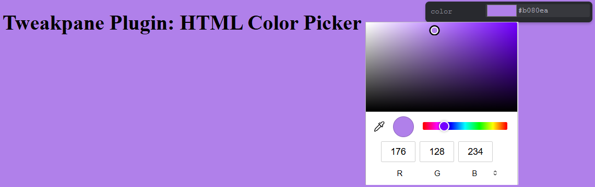

# Tweakpane HTML Color Picker Plugin


A Tweakpane plugin that replaces the default color picker with a native HTML5 color input for string color bindings. This is particularly useful as an alternative to Tweakpane's built-in color picker, which can sometimes be buggy.

## Installation

You can install this plugin via npm: 
[](https://www.npmjs.com/package/tweakpane-plugin-html-color-picker)

```bash
npm install tweakpane-plugin-html-color-picker
```

This plugin requires `tweakpane` as a peer dependency. If you don't have it installed, you'll need to add it via a npm:

```bash
npm install tweakpane
```

Or otherwise import it via CDN or locally.

## Usage

Simply import and register the plugin with your Tweakpane instance. When creating a binding for a string color input, ensure the `view` property is set to `'html-color-picker'` and the value it's binding to is a string in `'#rrggbb'` format.

```html
<!--- ES Module Example --->
<script type = 'module'>

  // Import Tweakpane v3.0.0 - v4.0.5
  import { Pane } from 'tweakpane';
  import { HtmlColorPickerPlugin } from 'tweakpane-plugin-html-color-picker';

  // Construct a pane
  const pane = new Pane();

  // Register the plugin
  pane.registerPlugin(HtmlColorPickerPlugin);

  // Object and it's property to bind to
  const params = {
    backgroundColor: '#cccccc', // Initial color in #rrggbb format
  };

  // Tweakpane v3 uses addInput, v4 uses addBinding
  pane.addBinding(params, 'backgroundColor', {
    view: 'html-color-picker', // Specify the custom view
    label: 'Background Color',
  });
</script>
```

## Examples

You can find a full working example of the plugin in the `test/` directory:

- `test/browser.html`: The HTML file that loads the example.

To run the example, you can use the `npm test` command:

```bash
npm test
```

This will start a local web server and open `test/browser.html` in your browser.

This example demonstrates how to use the plugin with tweakpane v3 or v4, as well as importing and using the plugin in ESM, CJS, and UMD formats.
